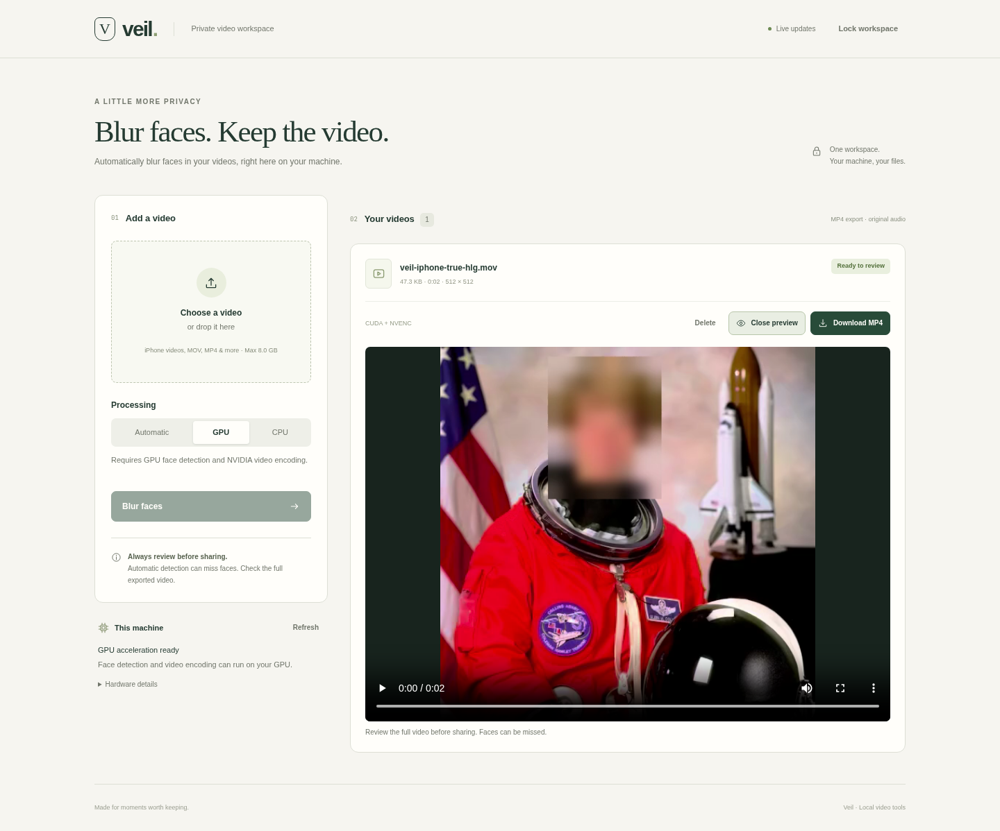

# Veil

Self-hosted face blurring and emoji covers for video. Upload a clip, track progress, review the result, and download an MP4. Single-user, password-protected, with private Tailscale access.

- Supports MOV/HEVC uploads, including iPhone recordings, rotation, and variable frame rates.
- Choose blur or emoji covers. Blur is the default; emoji expressions are approximate.
- Uses CUDA face detection and NVENC encoding when available; CPU mode is supported.
- Exports SDR H.264/AAC video. HDR is converted to SDR; source metadata is removed.
- Includes a persistent queue, live processed previews, cancellation, download, and deletion.
- Removes finished video files after seven days by default and keeps job history.
- Stores media locally. No telemetry or cloud processing.

**Review exports before sharing.** Detection can miss faces; audio and other identifying details remain.



## Setup

Requires Linux, Python 3.12, [uv](https://docs.astral.sh/uv/getting-started/installation/), and FFmpeg/FFprobe. GPU mode also requires a compatible NVIDIA driver and FFmpeg with `h264_nvenc`.

```sh
uv sync --locked --extra gpu
uv run veil init
uv run veil doctor
uv run veil serve
```

For CPU-only operation, replace `--extra gpu` with `--extra cpu`. `init` creates a password configuration and downloads the verified face and expression models. Existing installs can rerun `init` to add emoji support without changing credentials. Open <http://127.0.0.1:8765>.

See [deployment](docs/deployment.md) for Tailscale, Docker, configuration, and limits; [contributing](CONTRIBUTING.md) for development; and [architecture](docs/architecture.md) for implementation details.

## License

[MIT](LICENSE). YuNet has a separate [MIT notice](docs/licenses/YuNet-MIT.txt); the expression model uses [Apache 2.0](docs/licenses/Expression-Apache-2.0.txt). Dependencies retain their own licenses.
