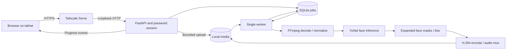

# Architecture

Veil uses FastAPI, SQLite, one processing worker, and a static browser interface. Media stays on the host.

## Modules

| Module | Responsibility |
| --- | --- |
| `config`, `cli` | Explicit initialization, environment loading, launch, capability checks. |
| `auth`, `app` | Password login, signed sessions, CSRF, bounded upload and authenticated media access. |
| `store`, `jobs` | Job state, persistent queue, one worker, cancellation, cleanup. |
| `media` | FFprobe validation and media normalization information. |
| `model`, `detector` | Pinned model download/checksum, CPU/CUDA inference, face boxes. |
| `pipeline` | Frame processing, progress callbacks, encoding, cancellation, subprocess lifecycle. |
| `static` | Accessible upload, progress, job actions, playback, and download. |

Uploads receive generated job IDs. The API accepts files rather than paths or remote URLs. Sources stay private; preview and download require a valid session and a completed job.

The worker processes one job at a time and reports backend, stage, frames, speed, progress, and estimated time remaining through SSE. The UI polls if SSE fails. Upload and processing progress are separate. SQLite preserves job history; an interrupted encode becomes a failed job and must be uploaded again.

Every frame passes through YuNet detection, expanded face masks, and a short tracking hold. Detection can still miss faces. Automatic mode reports any fallback; GPU mode requires CUDA inference and NVENC encoding. Decoding, masks, blur, and memory transfer use the CPU.

Initialization downloads the pinned model. Processing uses the local copy; the UI loads no remote assets or analytics. Dependency installation and Tailscale have their own network traffic.

## Extending video editing

New operations use the worker's progress and cancellation interface. Preserve the original, write temporary output, and mark completion only after the final export is ready. Pass subprocess arguments without shell interpolation. Cover rotation, audio, variable frame rates, HDR, failures, and cancellation when changing media handling.

## Model provenance

YuNet's `face_detection_yunet_2023mar.onnx` comes from [OpenCV Zoo at commit `47534e27c9851bb1128ccc0102f1145e27f23f98`](https://github.com/opencv/opencv_zoo/tree/47534e27c9851bb1128ccc0102f1145e27f23f98/models/face_detection_yunet).

SHA-256: `8f2383e4dd3cfbb4553ea8718107fc0423210dc964f9f4280604804ed2552fa4`.

The [model's MIT notice](licenses/YuNet-MIT.txt) is retained in the repository. The model binary is downloaded during explicit initialization and excluded from source control.
