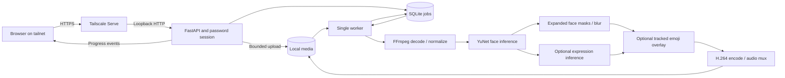

# Architecture

Veil uses FastAPI, SQLite, one processing worker, and a static browser interface. Media stays on the host.

## Modules

| Module | Responsibility |
| --- | --- |
| `config`, `cli` | Explicit initialization, environment loading, launch, capability checks. |
| `auth`, `app` | Password login, signed sessions, CSRF, bounded upload and authenticated media access. |
| `store`, `jobs` | Job state, persistent queue, one worker, cancellation, cleanup. |
| `retention` | Finished-media expiry, archived history, and stale upload cleanup. |
| `media` | FFprobe validation and media normalization information. |
| `model`, `detector` | Pinned model download/checksum, CPU/CUDA inference, face boxes and five landmarks. |
| `expression` | Aligned face crops and approximate expression classification for emoji selection. |
| `emoji` | Procedural artwork, stable track variants, and smoothed landmark geometry. |
| `pipeline` | Frame processing, progress callbacks, encoding, cancellation, subprocess lifecycle. |
| `static` | Accessible upload, progress, job actions, playback, and download. |

Uploads receive generated job IDs. The API accepts files rather than paths or remote URLs. Sources stay private; edited snapshots and finished exports require a valid session.

The worker processes one job at a time and reports backend, stage, frames, speed, progress, and estimated time remaining through SSE. The UI polls if SSE fails. Upload and processing progress are separate. SQLite preserves job history; an interrupted encode becomes a failed job and must be uploaded again.

Terminal transitions set stable completion and expiry timestamps. Retention removes the job's media before replacing it with an archived summary; failures retry without discarding history. Startup migration gives older finished jobs a full grace period after the worker lease is acquired. Cleanup shares a lifecycle lock with uploads and media responses, skips active jobs and transfers, and uses directory descriptors for contained deletion. Only recognized, unreferenced remnants older than 24 hours qualify as orphans.

After a fully affected frame is written to the encoder pipe, an optional callback captures a JPEG at most 640 pixels per edge, throttled to about once a second. Only the latest JPEG stays in application memory; SQLite stores its frame number and video timestamp. An authenticated, uncached endpoint serves it while the job is processing. Cancellation and terminal states clear the snapshot. The browser limits image requests to one at a time and pauses them when hidden.

Within a job, a single prefetch worker reads and detects the next frame while the current frame is masked and encoded. Tracking and output stay in source order. Only one next frame is buffered; large frames use the serial path when two BGR buffers would exceed 128 MiB. FFmpeg decode and filter threads are bounded by available CPU resources.

Every frame passes through YuNet detection, expanded face masks, and a short tracking hold. Detection can still miss faces. Automatic mode reports any fallback; GPU mode requires CUDA inference and NVENC encoding. Decoding, masks, blur, and memory transfer use the CPU.

Emoji jobs classify the original face crops before masking. The normal expanded blur is always applied before decorative overlays, including held masks during detection gaps. Tracks smooth expression and landmark changes and retain their artwork variant. At most 64 emoji tracks are kept; further detections remain blurred. Landmark pose is approximate 2D geometry, not a reconstructed 3D head.

Initialization downloads the pinned models. Processing uses local copies; the UI loads no remote assets or analytics. Dependency installation and Tailscale have their own network traffic.

## Extending video editing

New operations use the worker's progress and cancellation interface. Preserve the original, write temporary output, and mark completion only after the final export is ready. Pass subprocess arguments without shell interpolation. Cover rotation, audio, variable frame rates, HDR, failures, and cancellation when changing media handling.

## Model provenance

YuNet's `face_detection_yunet_2023mar.onnx` comes from [OpenCV Zoo at commit `47534e27c9851bb1128ccc0102f1145e27f23f98`](https://github.com/opencv/opencv_zoo/tree/47534e27c9851bb1128ccc0102f1145e27f23f98/models/face_detection_yunet).

SHA-256: `8f2383e4dd3cfbb4553ea8718107fc0423210dc964f9f4280604804ed2552fa4`.

The [model's MIT notice](licenses/YuNet-MIT.txt) is retained in the repository. The model binary is downloaded during explicit initialization and excluded from source control.

Emoji selection uses OpenCV Zoo's [MobileFaceNet expression model at the same pinned revision](https://github.com/opencv/opencv_zoo/tree/47534e27c9851bb1128ccc0102f1145e27f23f98/models/facial_expression_recognition), with its [Apache 2.0 notice](licenses/Expression-Apache-2.0.txt). Five landmarks align each crop to 112×112 pixels; the model selects among seven expression categories. These are approximate visual labels, not measurements of internal emotion.

SHA-256: `4f61307602fc089ce20488a31d4e4614e3c9753a7d6c41578c854858b183e1a9`.
