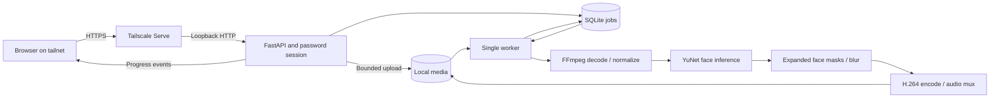

# Architecture

Veil has one FastAPI process, one persistent SQLite job store, one background processing worker, and a static browser interface. There are no tenants, accounts, external queues, or cloud media services.

## Modules

| Module | Responsibility |
| --- | --- |
| `config`, `cli` | Explicit initialization, environment loading, launch, capability checks. |
| `auth`, `app` | Password login, signed sessions, CSRF, bounded upload and authenticated media access. |
| `store`, `jobs` | Job state, persistent queue, one worker, cancellation, cleanup. |
| `media` | FFprobe validation and media normalization information. |
| `model`, `detector` | Pinned model download/checksum, CPU/CUDA inference, face boxes. |
| `pipeline` | Frame processing, progress callbacks, encoding, cancellation, subprocess lifecycle. |
| `static` | Accessible upload, progress, job actions, playback, and download. |

The browser uploads a file; it cannot request an arbitrary file path or remote URL. The server gives it a generated job ID and keeps source files private. Output preview/download require a signed session and a completed job.

The worker runs one job at a time. It reports backend, stage, progress, processed frames, speed, and remaining-time estimates. Progress is an estimate; upload completion is separate from processing completion. SQLite keeps history across restarts. A process interrupted during processing cannot resume that encode; it becomes a failed job so the user can upload again.

Every processed frame goes through detection. Expanded masks and a short tracking hold reduce visible gaps between detections. These measures do not establish that every face is hidden. In Auto mode, the pipeline may fall back and reports the backend it used. GPU mode requires both CUDA inference and NVENC encoding. CPU still handles decoding, masks, blur, and memory transfer.

The app's source, local data, and runtime network behavior are separate boundaries. Initialization downloads the fixed YuNet artifact; upload processing uses that local model. App pages contain no external scripts, fonts, analytics, or CDNs. Outbound dependency installation and Tailscale control-plane traffic are outside the media-processing path.

## Extending video editing

New processing features should operate inside the worker boundary and accept the same progress and cancellation signals. Keep the original upload immutable, write results to a temporary location, and only mark a job completed once the final output is ready. Keep external commands argument-based with no shell interpolation. Add fixture coverage for rotation, audio, variable frame rates, HDR conversion, failures, and cancellation when changing media handling.

## Model provenance

YuNet's `face_detection_yunet_2023mar.onnx` comes from [OpenCV Zoo at commit `47534e27c9851bb1128ccc0102f1145e27f23f98`](https://github.com/opencv/opencv_zoo/tree/47534e27c9851bb1128ccc0102f1145e27f23f98/models/face_detection_yunet).

SHA-256: `8f2383e4dd3cfbb4553ea8718107fc0423210dc964f9f4280604804ed2552fa4`.

The [model's MIT notice](licenses/YuNet-MIT.txt) is retained in the repository. The model binary is downloaded during explicit initialization and excluded from source control.
